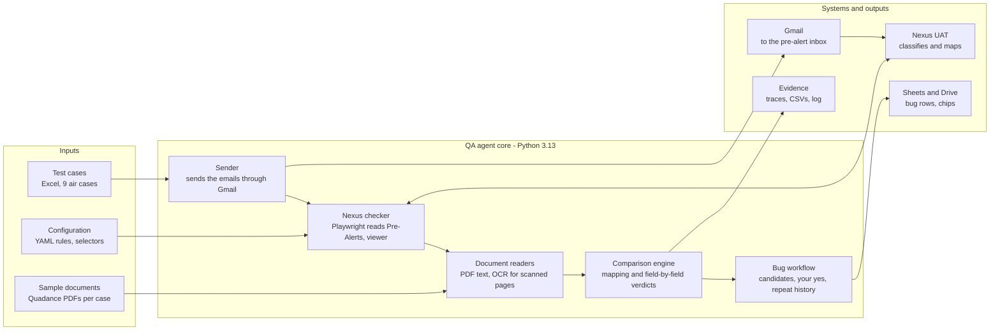

# About me: the Nexus E2E Regression QA Agent

## Summary

The QA agent sends real test pre-alert emails to Nexus UAT, then checks in the Nexus screens that every document was classified, mapped and extracted correctly. The source PDF is the truth. A tester only has to review the findings and confirm bugs.

- **Scope:** the Air Single House daily regression, 9 cases. 7 are covered (REG-001, 002, 003, 005, 006, 007, 009). REG-016 is not executable (hypothetical, no sample). REG-011 runs on request (sample split from FJ-0001012 plus a dummy unclassified document).
- **Latest result:** the sanity run on 28-Oct passed the mapping check on all six cases it executed.
- **Bugs:** 12 logged in the UAT bug sheet with screenshots. Rows 240, 241 and 245 were re-tested and confirmed fixed.
- **Control:** nothing is written to the bug sheet until the tester says yes to that bug.

## Architecture

The agent reads the Excel test cases, the sample PDFs and the YAML rules. Its core sends mail through Gmail and drives the Nexus UI. It reads the PDFs, compares them with what Nexus shows, and manages bugs. Results go to evidence files and the UAT bug sheet on Drive.

## How it works

One run takes a test case from the Excel sheet to a confirmed bug in eight steps.

1. **Read the test case.** Scenario, documents and expected mapping come from the team's Excel sheet.
2. **Send.** The sample PDFs go to the pre-alert inbox through the Gmail API, as one email (consolidated) or one email per document (individual), with a standard subject such as `REG-007 | QA agent trigger`.
3. **Wait.** The agent polls the Nexus Pre-Alerts list until the pre-alert appears and records how long it took.
4. **Check the mapping.** It opens the viewer and reads which documents are Linked, Unmatched or Unclassified under the Master, House and Manifest, plus any follow-up emails in the Others tab, and compares them with the expected mapping.
5. **Check the data.** It reads the fields Nexus extracted and compares each one with the source PDF.
6. **Judge.** Each check gets a verdict and, on a failure, a probable root cause.
7. **Record.** Screenshots, CSV reports, the progress log and the bug history are saved.
8. **Report.** Failures become bug candidates. Only after the tester confirms one is it written to the bug sheet with its evidence.

## What it checks

It checks two things on every case: where each document landed, and whether the extracted data matches the PDF.

- **Mapping:** each document is classified correctly and sits in the right place, for example Master and Manifest under the Master, Invoice and Packing List under the House, Delivery Note under the House.
- **Data:** the Master, House, Manifest, Invoice and Packing List fields are compared one by one with the document, which is the source of truth.
- **Scanned documents:** OCR reads the page. Differences on a scan are marked REVIEW, never FAIL, because OCR can misread.
- **Verdicts:** PASS, FAIL, REVIEW, INFO, NOT_VERIFIABLE, and KNOWN for a bug that was already raised. A known bug does not fail the run but is listed every day as still there until it is fixed.

## Tools and technology

The agent is a Python 3.13 program that uses free, standard libraries and the team's own Google accounts.

| Area | Tool | Used for |
| --- | --- | --- |
| Language and tests | Python 3.13, pytest | The agent itself, and 88 automated tests that protect it |
| Configuration | YAML files | Check rules and Nexus screen selectors, so a UI change is a config edit |
| Test cases | Excel workbook | Scenario, documents and expected mapping per case |
| Sending | Gmail API | Sends the test pre-alert emails |
| Nexus UI | Playwright (Chromium) | Drives the Nexus screens with a login saved once by hand; no password is stored |
| PDF reading | pdfplumber, pypdf, pypdfium2 | Text and pages of the source documents |
| Scanned pages | RapidOCR (ONNX, runs on CPU) | Reads documents that have no text layer |
| Bug tracking | Google Sheets API, Google Drive API | Writes bug rows and attaches screenshots and PDFs as Drive chips |
| State | SQLite | Sent emails, bug candidates, bug history |
| Source control | Git, GitHub | History of the framework; credentials and session files stay out of Git |
| Assistant | Claude Code | Builds and operates the agent with the tester |

## Evidence and bug workflow

Every check leaves evidence a developer can open, and a person decides what becomes a bug.

- **Trace per check:** numbered screenshots in the order they were taken: the Pre-Alerts page, the expanded row with its Unresolved Documents, each viewer parent, each linked document, and the Others tab. An index page shows them with captions and the probable root cause.
- **Reports:** CSV files for each validation, so results can be compared over time.
- **Bug candidates:** a failure becomes a candidate, not a bug. The tester reviews each one and answers yes or no.
- **On yes:** the agent adds the row to the UAT bug sheet with the Pre-Alerts screenshot and the source PDF as Drive chips.
- **Re-test:** after a fix the case is run again and the re-test status, job number and screenshots are added to the same row.
- **Repeat tracking:** an internal history counts how often each bug appears, so repeated and fixed bugs are visible.

## Advantages

The framework makes the regression repeatable, deeper than a manual check and easy to prove.

- **Repeatable:** the same case, files and checks run the same way every time, so a result can be compared with the last run.
- **Field-level coverage:** every extracted field is compared with the PDF, not only whether the document was mapped.
- **Finds intermittent bugs:** REG-007 was run five times and showed five different groupings and a misclassified Invoice, which a single manual pass could have missed.
- **Evidence by default:** every check has a screenshot trace and root-cause hints, so developers can reproduce an issue quickly.
- **Safe by design:** nothing is logged to the bug sheet without the tester's yes, and no Nexus password is stored.
- **Regression memory:** already-raised bugs are listed as still there each day, and the history shows when they are fixed.
- **Easy to extend:** a new case needs its sample files and a row in the Excel sheet; UI changes are fixed in configuration.

## Current coverage and results

7 of 9 cases are covered, and the mapping check passed on all six cases executed in the 28-Oct sanity run. REG-016 is not executable. REG-011 has a sample (FJ-0001012 split plus a dummy document) and can run.

| Case | Scenario | Result |
| --- | --- | --- |
| REG-001 | Consolidated | Mapping PASS |
| REG-002 | Consolidated | Mapping PASS; known Packing List bug (row 236) still there |
| REG-003 | Covered through REG-007 | 2 bugs logged (rows 237, 238) |
| REG-005 | Consolidated | Mapping PASS |
| REG-006 | Individual | Mapping PASS; rows 240 and 241 re-tested as fixed |
| REG-007 | Individual | Mapping PASS; row 245 re-tested as fixed |
| REG-009 | Scanned document | Mapping PASS |
| REG-011 | Individual | Sample built from FJ-0001012 + a dummy unclassified document; ready to run |
| REG-016 | Individual | Not executable: hypothetical case, no sample |

Next: samples for the two pending cases, data checks for individual cases that span several pre-alerts, the CargoWise/XML check, and automatic clean-up of old pre-alerts.

## Limitations

- **UAT only:** it runs against the UAT Nexus, and old pre-alerts must be deleted by hand before a re-run, otherwise the new emails create duplicates.
- **Depends on the screens:** a Nexus UI change can break a selector; the fix is a configuration edit.
- **Email timing:** emails are sent one by one, 30 s apart (`local_docs.email_gap_seconds`), because Nexus can group parallel emails wrongly.
- **Individual cases:** the run now validates them like the others (mapping, then Master, House and document data on the main pre-alert); follow-up emails in Others are listed, not data-checked.
- **Reader limits:** on non-standard layouts a field can be misread, and OCR results on scans need a human look, so they are marked REVIEW.
- **Nexus timing:** Nexus can take minutes to settle, so a check made too early can show an incomplete result. The agent waits before validating.
- **Human decision:** a person must confirm each bug, by design.

## Roadmap: skill and knowledge graph

Proposed next step: package the framework as a shared skill, then add a knowledge graph of cases, runs, documents and bugs. Full plan: [ROADMAP_SKILL_AND_KNOWLEDGE_GRAPH.md](ROADMAP_SKILL_AND_KNOWLEDGE_GRAPH.md).

| Phase | What | Effort |
| --- | --- | --- |
| 1. Skill | One shared instruction file so anyone on the team runs the regression the same way, with the safety rules built in | Small |
| 2. Knowledge notes | Written notes on document types, Nexus behaviour and known bugs | Small |
| 3. Graph build | A map of test cases, runs, pre-alerts, documents, check results, bugs and root causes, built from data the agent already stores | Medium |
| 4. Graph questions | One-command answers: repeated bugs, most misclassified documents, bugs without a re-test | Medium |
| 5. Feed back | Failure reports show earlier occurrences automatically | Small |

Recommendation: start with phases 1 and 2, and build the graph once the skill has been used for a few weeks.
