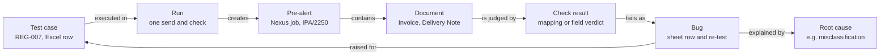

# Roadmap: Skill and Knowledge Graph for the QA Agent

*Plan dated 2026-10-28.*

## Recommendation

Yes to both. Build the skill first, because it is small and removes the biggest risk today; build the knowledge graph second, on data the agent already stores.

| | What it is | What it gives | Effort | Order |
| --- | --- | --- | --- | --- |
| Skill | A shared instruction file the AI assistant loads on request, with the run steps and the working rules | Anyone on the team runs the same regression the same way, with the safety rules enforced | Small | 1 |
| Knowledge notes | Short pages on document types, Nexus behaviour and known bugs | The assistant and the root-cause hints stop relying on one person's memory | Small | 2 |
| Knowledge graph | A map linking cases, runs, pre-alerts, documents, bugs and root causes | Answers such as which bugs repeat, which documents are misclassified most, which bugs have no re-test | Medium | 3 |

## Where we are today

The working rules live in the assistant's personal memory on one machine, so a new tester or a new session starts without them.

- **Rules:** retrigger only on request, ask whether old pre-alerts are deleted before any send, confirm each bug before it is logged, always capture the Pre-Alerts screenshots, keep the progress log updated. These are saved as memory notes for one user, not in the repository.
- **Run instructions:** `regression_prompts/` holds a prompt per suite (for example AIR_SINGLE_HOUSE_DAILY) and `EXECUTE_CMD.md` lists the commands.
- **Knowledge:** the `knowledge_base/` folder holds sample documents and the test-case workbooks. It has no written notes on document types or Nexus behaviour.
- **Data:** a local SQLite database already stores sent emails, bug candidates and a bug history, and each run writes CSV reports and screenshot traces.
- **Skills:** the repository has no skill yet, and the `.claude` folder is excluded from Git.

## Knowledge graph design

The graph is built from data the agent already stores, so it adds no new data entry for the tester.

Read from a test case: each run creates a pre-alert, which contains documents; each document is judged by a check result, and a failed check becomes a bug that is explained by a root cause and points back to its test case.

- **Built from:** the SQLite database (sent emails, bug candidates, bug history), the CSV reports of every run, the trace folders, the progress log and the UAT bug sheet rows.
- **Technology:** a Python graph library inside the agent, saved as a file in the repository, with an HTML view. A graph database server is not needed at this size.
- **Questions it answers:** which bugs repeat across cases and runs; which document types are misclassified most; which bugs have no re-test yet; which root causes (for example Nanonets misclassification) explain several bugs; the full history of one case.

## Phased plan

Five phases, each usable on its own, so value arrives from phase 1.

| Phase | Deliverable | Done when | Effort |
| --- | --- | --- | --- |
| 1. Skill | A `nexus-regression` skill in the repository with the run steps, commands, verdict meanings, evidence conventions, and the working rules (retrigger only on request, confirm each bug, ask about old pre-alerts) | A new session runs the sanity run from the skill alone and follows every rule without being reminded | Small |
| 2. Knowledge notes | Short pages under `knowledge_base/`: document types and how they look, Nexus behaviour (follow-ups in Others, intermittent grouping, wait before validating, Nanonets classification), and known bugs | The skill points to the notes and the assistant answers "why does Nexus do this" from them | Small |
| 3. Graph build | A command that builds the graph from the database, reports and bug sheet rows | The graph reproduces today's facts: runs per case, 12 logged bugs, and which are fixed | Medium |
| 4. Graph questions | Ready-made queries and an HTML view: repeated bugs, most misclassified documents, bugs without a re-test, history of one case | The tester gets each answer in one command | Medium |
| 5. Feed back | Root-cause hints in each trace cite the graph (for example "seen before in row 245"), and the daily summary uses it | A new failure shows its earlier occurrences automatically | Small |

## Risks and decisions needed

Three decisions are needed before phase 1 starts.

- [ ] **Commit the skill to the repository?** It lets the whole team use it, but the repository is public, so the skill must hold no credentials, no customer data and no internal URLs beyond what is already public.
- [ ] **First graph questions:** which three questions matter most to the manager? They decide what phase 4 builds first.
- [ ] **Sea cases:** include them in the skill now, or keep it to air single house until those cases are automated?

Risks to manage:

- **Two sources of truth:** the graph must be rebuilt from the database and the sheet, never edited by hand, so it cannot drift.
- **Stale notes:** the knowledge notes need an owner and are updated with the progress log.
- **Over-building:** the graph is worth it only if its answers are used, so phases 3 to 5 start after the skill has run for a few weeks.
